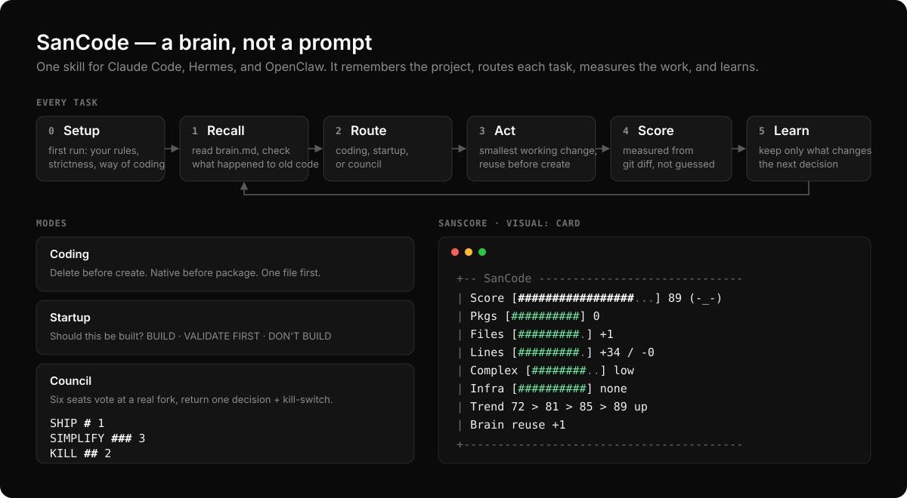

# SanCode

Write less. Ship more.

.png)

SanCode is a coding standard for AI agents that cuts AI-generated code bloat, unnecessary abstractions, and dependency addiction.

> Every line of code must justify its existence.

It is not a framework, a library, or another layer in your stack. It is a set of rules, and now a **skill with a brain**, that you plug into Claude Code, Codex, Cursor, OpenClaw, Hermes Agent, Windsurf, and other AI coding agents so they stop turning simple product work into architecture cosplay.



## Quick Start

**Option 1: the skill (recommended).** Claude Code, Hermes, and OpenClaw. Includes the brain, setup, all modes, and the visual SanScore.

```bash
git clone https://github.com/HoratiuCode/sancode.git && cd sancode

cp -r skill/sancode ~/.claude/skills/sancode              # Claude Code: /sancode
cp -r skill/sancode ~/.hermes/skills/sancode              # Hermes: "apply sancode"
cp -r skill/sancode ~/.openclaw/workspace/skills/sancode  # OpenClaw: just ask
```

Then ask for any coding task. The first time, SanCode runs a short setup.

**Option 2: one rules file.** Any agent, no memory. Copy the file for your agent into your project:

| Agent | File | Where it goes |
|---|---|---|
| Claude Code | `CLAUDE.md` | project root |
| Codex | `CODEX.md` | project root |
| Cursor | `CURSOR.md` | project root |
| OpenClaw | `OPENCLAW.md` | paste into `~/.openclaw/workspace/AGENTS.md` |
| Hermes Agent | `HERMES.md` | project root (Hermes loads it before `AGENTS.md`) |

Or just prompt:

```text
Apply SanCode.
Before writing code, delete, reuse, simplify, or explain why code is required.
End with SanScore.
```

## How the Brain Works

Every task runs the same loop:

| Step | What happens |
|---|---|
| **0 Setup** | First run only. Reads your repo, then asks how you think and code. |
| **1 Recall** | Reads `.sancode/brain.md`. Checks git for what happened to its past code. Flags decisions due for review. |
| **2 Route** | Picks Coding, Startup, or Council Mode. |
| **3 Act** | Makes the smallest working change. Checks the Reuse map before writing anything new. |
| **4 Score** | Measures the change from `git diff` and prints the SanScore. |
| **5 Learn** | Saves only what changes the next decision. |

### Setup

The first time SanCode runs in a project, it reads your package files, configs, and README, shows what it found, then asks once:

1. What are you building, and what stage? (idea / pre-revenue / paying users)
2. How strict should I be? (strict / balanced / relaxed)
3. Non-negotiables: tools or choices I must never argue with?
4. Your rules: things I must always or never do?
5. How do you work? (just code / plan briefly then code / explain options and wait)
6. When should the council convene? (at real forks / only when asked / off)
7. Brain shared (commit it) or private (`.gitignore`)?
8. Show the score as a picture? (off / bar / card)

Every question has a default. Say "defaults" to skip. **Your rules always beat SanCode's.** Rerun anytime with `sancode setup`.

### It learns from what happens to its code

Next session, SanCode checks git for what you did to the code it wrote:

- **kept**: still there, good sign
- **rewritten**: it reads your change, works out what you preferred, and saves a lesson
- **reverted**: it saves why

```text
[outcome] user replaced my fetch wrapper with plain fetch calls: don't wrap fetch
```

From then on it follows that lesson like a direct instruction. If you overrule it once in chat, it stops arguing.

### The brain file

One Markdown file, `.sancode/brain.md`, about 120 lines at most. It cleans itself up: merges duplicates, drops old decisions, never touches your rules.

```markdown
## Profile      what you're building, stage, stack, existing deps
## Settings     strictness, way of working, council, visual
## Rules        your non-negotiables and always/never rules
## Reuse        format a date → lib/format.ts:formatDate
## Decisions    2026-10-27 | Native search | kill-switch: p95 > 300ms by 2026-12-01 | open
## Lessons      [user] keeps Postgres · [outcome] use plain fetch
## Scores       2026-10-27 | add search | 89 | coding | files: search.ts | outcome: kept
```

Commit it to share with your team, or ignore it to keep it personal.

## Modes

### Coding Mode (default)

Before writing code: does this already exist? Can I reuse it, simplify it, remove it? Will users care or pay? Can it launch today?

- Delete before create
- Native before package (say why native is worse before adding one)
- One file before many, no `utils/`, `services/`, `managers/`, `core/` for one helper
- Direct before abstract
- Don't automate something that happened once

### Startup Mode

Say "startup mode", or SanCode switches to it when a feature's value is unproven.

- Can this be validated manually this week?
- Can it be sold before it is built?
- Can a landing page, form, spreadsheet, or email do the job?
- Is a customer waiting for it, by name?

Returns **BUILD**, **VALIDATE FIRST**, or **DON'T BUILD**, plus one step doable in under 48 hours. Many "technical tasks" are fear or fake progress wearing a hoodie. "This should not be built yet" is a feature.

### Council Mode

Startup Mode asks *whether* to build. Council Mode decides *how* at a real fork: a new dependency, new infrastructure, a rewrite, build vs buy, ship vs polish. Say "council mode", or SanCode convenes it before acting. Never for routine edits or bug fixes, and never twice for the same question.

Six seats speak in order, three lines each:

| Seat | Asks |
|---|---|
| Customer | What breaks for a user without this? |
| CFO | Hours to build and to maintain? |
| CTO | Thinnest version that proves the risky part? |
| Maintainer | Who debugs this in 6 months? |
| Chief Risk | The 90-day post-mortem, written now |
| Lead | Decides last, says why |

They vote SHIP / SIMPLIFY / KILL / DEFER. The result is one decision, a kill-switch that reverses it, and a first move. The decision is saved to the brain. For business calls (pricing, hiring, pivots), use the full Council skill.

### Infrastructure Mode

Built into every mode. SQLite before Postgres. One server before microservices. Cron before queues. Files before object storage. In-memory before Redis. No Redis, Kubernetes, queues, or workers until current usage proves the need.

## SanScore

Every task ends with a score out of 100. Higher means simpler. In a git repo it is **measured**, not guessed:

| Added | Points |
|---|---|
| Each package | −10 |
| Each new file | −5 |
| Every 20 lines added | −1 (max −20) |
| Every 20 lines deleted | +1 (max +10) |
| Complexity low / medium / high | −5 / −15 / −30 |
| Each piece of infrastructure | −15 |

### Visual

Pick a style at setup, or say `sancode visual bar`, `sancode visual card`, or `sancode visual off`. Plain ASCII, so it renders in every terminal and chat.

**Bar** (default):

```text
[#################...] 89/100 (-_-)  trend 72 > 81 > 85 > 89  up
```

**Card**:

```text
+-- SanCode ---------------------------------
|  Score    [#################...] 89  (-_-)
|  Pkgs     [##########]  0
|  Files    [#########.]  +1
|  Lines    [#########.]  +34 / -0
|  Complex  [########..]  low
|  Infra    [##########]  none
|  Trend    72 > 81 > 85 > 89  up
|  Brain    reuse +1
+--------------------------------------------
```

Faces: `(^_^)` 90+, `(-_-)` 70–89, `(o_o)` 50–69, `(x_x)` below 50. Council votes get a tally chart too.

## Commands

| Say | Does |
|---|---|
| `sancode setup` | Rerun setup, change rules and settings |
| `startup mode` / `sancode startup` | Should this be built at all? |
| `council mode` / `sancode council` | Convene the council on the current fork |
| `sancode code` | Force Coding Mode |
| `sancode visual bar` / `card` / `off` | Change the score visual |

## Principles

1. Delete before create
2. Native before package
3. Simple before abstract
4. Single file before architecture
5. Working before perfect
6. Ship before optimize
7. Revenue before scale
8. Users before infrastructure

## What SanCode Fights

| Against | For |
|---|---|
| Installing a package for one function | Small diffs |
| Services before there are users | Native platform features |
| Splitting tiny features into fake architecture | Boring code |
| Admin dashboards before revenue | Revenue pressure |
| Queues, caches, and workers for imaginary scale | Single-server thinking |
| Generalized code for one known use case | Customer proof |
| Refactoring code customers haven't validated | Shipping today |

## Examples

`examples/` compares **AI Slop Solution vs SanCode Solution** for:

- Date picker and CSV processing
- Search and authentication
- Dashboard

## The Rule

Before you ask an AI agent to build, ask it to remove.

Before you ask it to architect, ask it to ship.

Before you ask it to scale, ask whether anyone cares.
